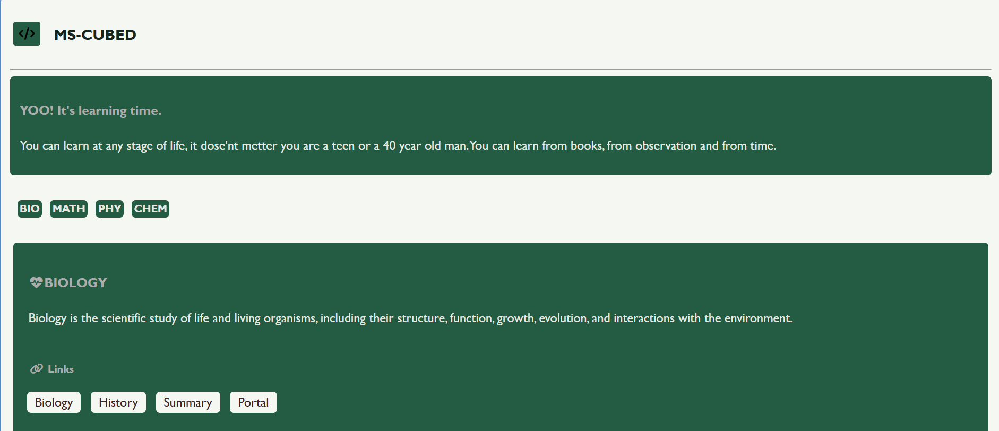
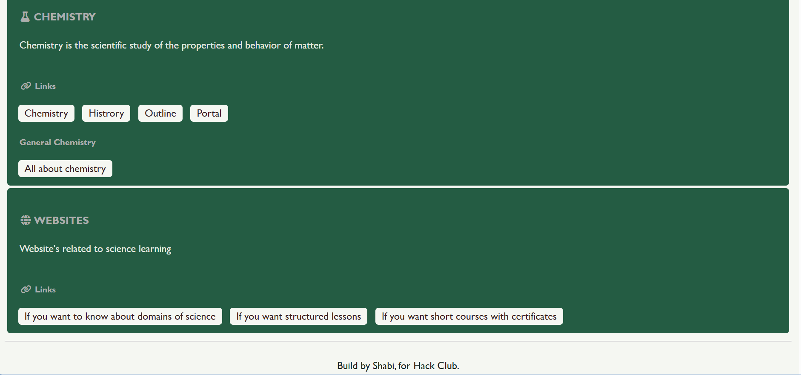

# MS-CUBED
YOO! Guy's you can visit my Site if you are looking for learning new things about science. This site cover 4 main branches of science like Biology, Math, Physics, Chemistry.
## Screen shots







## Description

MS-CUBED is web-based science learning hub created for students, who want to learn through animation or by reading. It features direct Wikipedia links, and 3d animation/video resources for Bio, Math, Physics, Chem. The web is built with the help of HTML and CSS styling for making the web beautifull.    

**THROUGH THIS LINK YOU CAN VISIT [My site](https://msdatahub58.github.io/MS-CUBED/).**


**Required things to run web :** 
* Web browser like Google Chrome, Microsoft Edge, Fire Fox, etc.
* An active internet connection to load external links, icons, and                Youtube/Wikipedia resources.

## Subject covered:

**BIOLOGY:** About History, Summary, human body structure. 

**PHYSICS:** History, Laws.

**MATH:** Logic, Fields.

**CHEM:** All about Chem, branches, laws, etc.

## Installing

* Clone the repo or download the ZIP folder directly from Github:
  ```bash
  git clone [https://github.com/msdatahub58/PROGRAMMING.git](https://github.com/msdatahub58/PROGRAMMING.git)


## Executing program
* How to run the program
    1. Open project folder on your device.
    2. Double click on the **index.html** file to launch it in your browser.
    3. Or you can host it live using GitHub page.


## Help

* If the icons or online links fail to respond please check your internet        connection.
  


**Code by Shabi** for Hack Club
